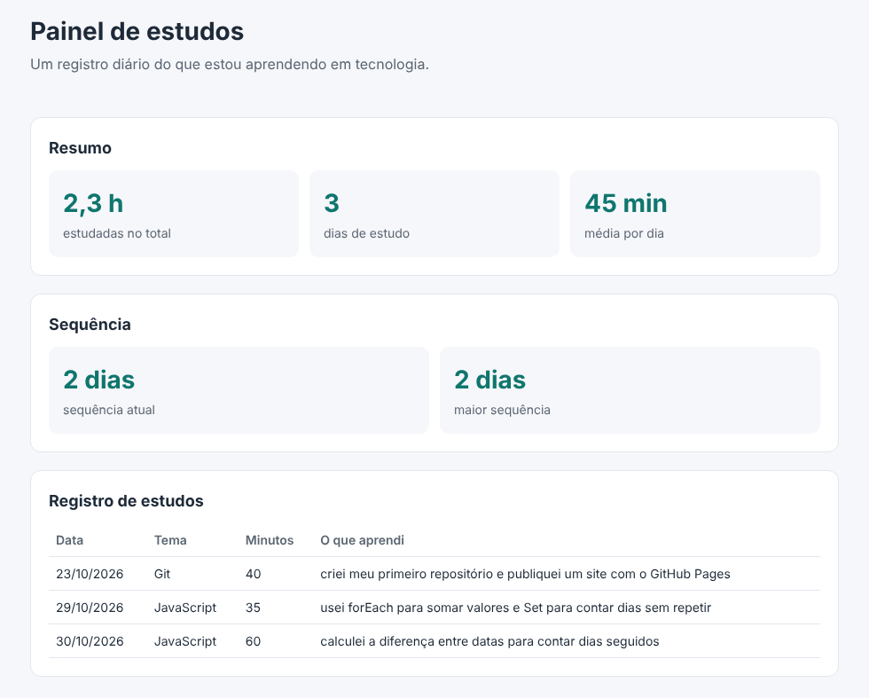

<h1 align="center">📚 Painel de estudos</h1>

<p align="center">
  Um registro diário do que estou aprendendo em tecnologia, transformado em um site.
</p>

<p align="center">
  <a href="https://gabrielevaristo77.github.io/painel-de-estudos/">
    
  </a>
  
  
  
</p>

<p align="center">
  <a href="https://gabrielevaristo77.github.io/painel-de-estudos/">
    
  </a>
</p>

---

## 💡 A ideia

Em vez de só estudar, decidi **registrar cada dia de estudo e construir o próprio painel enquanto aprendo**. Cada conteúdo novo vira uma funcionalidade do site, então o projeto cresce junto com o que eu sei.

## ⚙️ Como funciona

A cada dia de estudo, adiciono uma linha no arquivo [`dados/estudos.csv`](dados/estudos.csv) com a data, o tema, os minutos estudados e o que aprendi. A página lê esse arquivo e monta o painel sozinha, sem banco de dados e sem bibliotecas.

```
painel-de-estudos/
├── index.html        página principal
├── css/              estilos de cada parte do painel
├── js/               uma funcionalidade por arquivo
└── dados/
    └── estudos.csv   meu registro de estudos
```

## ✅ Funcionalidades

| Status | Funcionalidade | O que aprendi fazendo |
|:---:|---|---|
| ✅ | Tabela com todos os registros | Ler um arquivo CSV com `fetch` e montar HTML com JavaScript |
| ✅ | Resumo com total de horas, dias e média | Somar valores com `forEach` e contar dias únicos com `Set` |
| ✅ | Sequência de dias seguidos | Trabalhar com datas e comparar cada dia com o anterior |
| ✅ | Tempo por tema | Agrupar minutos por assunto com um objeto e desenhar barras proporcionais com CSS |
| ✅ | Mural com os últimos aprendizados | Copiar uma lista com `slice`, ordenar por data com `sort` e pegar só os primeiros itens |
| ✅ | Calendário de estudos | Descobrir quantos dias tem o mês com `new Date(ano, mes + 1, 0)` e em que dia da semana ele começa com `getDay()` |

## 🛠️ Tecnologias

- **HTML, CSS e JavaScript puro**, sem bibliotecas
- **Git e GitHub** para versionar, com commits todos os dias de estudo
- **GitHub Pages** para publicar o site

---

<p align="center">
  Feito por <a href="https://github.com/GabrielEvaristo77">Gabriel Evaristo</a> · estudante de ADS na UNICID
</p>
